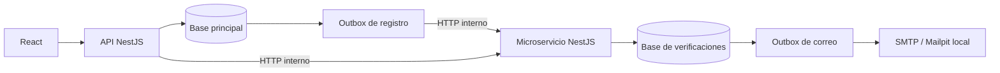

# Peak Paz

Plataforma de rutas, guías y salidas grupales en La Paz. El repositorio contiene la web pública, la API principal y un microservicio independiente de verificación de cuentas y credenciales.

## Ejecutar en la laptop

Requisitos: Node.js 24 o posterior, npm y Docker con Compose.

Desde la raíz del repositorio:

```bash
npm run install:all
npm run dev
```

`dev` prepara los archivos `.env` que falten, genera secretos locales, construye el microservicio, inicia PostgreSQL y Mailpit, aplica las migraciones, crea el administrador si no existe e inicia la API y la web. Conserva los datos de los volúmenes existentes.

| Componente | Dirección local |
| --- | --- |
| Web | http://localhost:5173 |
| Registro de turista o guía | http://localhost:5173/registro |
| Estado de verificación | http://localhost:5173/mi-verificacion |
| Revisión de guías, solo administrador | http://localhost:5173/admin/verificaciones |
| Buzón de correos de prueba | http://localhost:8025 |
| API y Swagger | http://localhost:3010/api/docs |
| Salud del microservicio | http://localhost:3020/health |

El administrador inicial usa el correo de `SEED_ADMIN_EMAIL` y la contraseña de `SEED_ADMIN_PASSWORD` en `backend/.env`. Los secretos se guardan en archivos ignorados por Git; no deben publicarse. Ejecutar de nuevo `npm run setup` conserva los valores configurados.

Para cargar rutas de demostración:

```bash
npm run seed:demo --prefix backend
```

Ctrl+C detiene la API y la web. Para detener los contenedores, conservando los datos:

```bash
docker compose down
```

## Verificación de cuentas

### Turistas

1. Se registran con nombre, apellido, correo y contraseña.
2. Reciben una sesión con acceso limitado y un enlace de confirmación.
3. Abren el correo en Mailpit y pulsan **Confirmar mi correo**.
4. La API habilita las operaciones de reserva después de confirmar el correo.

No se solicita CI o pasaporte al turista. La confirmación prueba acceso al correo, no la identidad civil de su propietario.

### Guías

1. Se registran con los datos de cuenta, CI declarada, idiomas y experiencia.
2. Confirman el correo y cargan CI, credencial de guía y certificado de primeros auxilios.
3. Solicitan revisión desde **Mi verificación**.
4. El administrador descarga y revisa los documentos desde **Revisar guías**.
5. El administrador aprueba o rechaza; un rechazo requiere un motivo. El guía puede corregir los documentos y volver a solicitar revisión.

Se aceptan PDF, JPG y PNG de hasta 5 MB. Se comprueban la presencia, el tipo de archivo y las fechas de vencimiento declaradas. La decisión queda en el historial del microservicio con el administrador y la fecha.

La autenticidad documental se revisa manualmente. No hay consulta a SEGIP, registro de profesionales u otra entidad emisora, ni se presenta la comprobación de formato como prueba de autenticidad. Un futuro proveedor de identidad se puede integrar detrás del servicio manteniendo este flujo de revisión.

Reemplazar o eliminar un documento de un guía aprobado retira su aprobación y exige otra revisión. Los datos de identidad aprobados quedan bloqueados. Un guía con documentos vencidos queda fuera del catálogo y del acceso a operaciones de guía aunque conserve una sesión anterior.

Los turistas y guías que ya existían antes de esta actualización también deben confirmar su correo. Los administradores y las agencias mantienen su acceso anterior.

## Arquitectura



- `frontend/`: formularios de turista y guía, confirmación de correo, documentos y panel administrativo.
- `backend/`: usuarios, contraseñas, sesiones, permisos, archivos privados y negocio turístico. Mantiene una copia local de `emailVerifiedAt` para comprobar permisos sin consultar al microservicio en cada petición.
- `verification-service/`: casos de verificación, enlaces, solicitudes documentales, decisiones e historial. Se ejecuta y se despliega por separado, con otra base PostgreSQL y su propio Dockerfile.
- `scripts/`: preparación local, arranque y pruebas de integración aisladas.

El microservicio recibe solo los datos necesarios. Nunca recibe contraseñas, hashes de contraseñas ni JWT de usuarios. Los archivos originales permanecen en el almacenamiento privado de la API y solo sus propietarios y administradores pueden descargarlos. El microservicio registra las referencias y metadatos de los documentos revisados, sin relaciones de base de datos entre servicios.

### Persistencia y reintentos

El registro de una cuenta y la solicitud de verificación se guardan en la misma transacción mediante `@nestjs/outbox`. Si el servicio no está disponible, la cuenta sigue pendiente y el relay reintenta. El servicio registra a su vez la emisión de correo y su tarea de envío en una única transacción.

Crear repetidamente el mismo caso es idempotente: no envía nuevos enlaces ni cambia el destinatario. Los enlaces vencen a los 30 minutos, son de un solo uso y se almacenan mediante hash; el secreto de emisión y un nonce permiten reconstruirlos al enviar sin guardar el enlace en la cola. Reenviar invalida el enlace anterior y tiene un intervalo mínimo de 60 segundos. La confirmación usa POST; abrir el enlace no lo consume. El token viaja en el fragmento del enlace para no incluirse en los registros HTTP de navegación.

Los reintentos de envío conservan el mismo identificador de mensaje. SMTP no garantiza entrega exactamente una vez: ante una caída en el momento del envío puede llegar más de una copia del mismo enlace, que solo se podrá consumir una vez.

Las decisiones usan una instantánea de los datos y documentos. Los cambios posteriores generan una revisión distinta. Los bloqueos de base de datos coordinan las modificaciones de documentos con las decisiones administrativas para impedir que una aprobación antigua se aplique a documentos reemplazados.

### API pública, a través del backend

| Método | Ruta | Acceso |
| --- | --- | --- |
| GET | `/api/verification/me` | Usuario autenticado, su propio caso |
| POST | `/api/verification/email/resend` | Usuario autenticado, su propio correo |
| POST | `/api/verification/email/confirm` | Público; cuerpo `{ "token": "…" }` |
| POST | `/api/guides/me/verification-request` | Guía con correo confirmado y documentos completos |
| GET | `/api/verification/admin/users/:id` | Administrador, historial de una cuenta |
| PATCH | `/api/admin/guides/:id/verification` | Administrador; decisión y motivo |
| GET | `/api/verification/admin/delivery-failures` | Administrador, solicitudes agotadas |
| POST | `/api/verification/admin/delivery-failures/:id/retry` | Administrador, reintento de solicitud agotada |

Las rutas `/internal/*` del microservicio exigen `X-Service-Key`. La clave nunca se incluye en el frontend. Su API interna incluye creación y consulta de casos, reenvío y confirmación, presentación de revisiones y decisiones. `/internal/delivery-failures` y `/internal/delivery-failures/:id/retry` permiten inspeccionar y reintentar los envíos que agotaron sus intentos, usando la misma credencial interna.

## Correo real y configuración

En desarrollo, Mailpit captura todos los mensajes. No los entrega a las direcciones externas que aparezcan en los formularios.

Para enviar correos reales, configurar `SMTP_URL` y `MAIL_FROM` con un servidor autorizado, y `PUBLIC_WEB_URL` con la dirección pública de la web. En el Compose de desarrollo, `SMTP_URL` está sobrescrita a `smtp://mailpit:1025`: hay que sustituir esa entrada al preparar un despliegue real. En producción, el transporte exige STARTTLS o TLS.

`VERIFICATION_SERVICE_KEY` debe coincidir entre backend y microservicio. `EMAIL_TOKEN_SECRET` es un secreto diferente y estable para emitir los enlaces; cambiarlo invalida los enlaces pendientes. Las bases de datos usan credenciales independientes. Los puertos de desarrollo se publican solo en localhost.

Ambas aplicaciones aplican migraciones al arrancar, incluidas las del outbox. Esto exige un usuario de base de datos con permisos de migración; para producción se debe establecer una política de despliegue, secretos, retención de documentos y copias de seguridad acorde con el entorno.

## Cuentas ficticias para exponer el microservicio

Con el entorno local iniciado, ejecutar:

```bash
npm run demo:guides
```

Crea cinco guías ficticios con estos correos y la contraseña común `GuiaDemo2026!`:

| Correo | Escenario inicial |
| --- | --- |
| `demo.guia.correo@example.com` | Correo sin confirmar y sin documentos |
| `demo.guia.documentos@example.com` | Correo confirmado y solo CI de prueba cargada |
| `demo.guia.revision@example.com` | Documentos completos y revisión solicitada |
| `demo.guia.correccion@example.com` | Rechazo con motivo; incluye una credencial corregida para reemplazar |
| `demo.guia.aprobada@example.com` | Correo y credenciales aprobados |

El comando utiliza el registro y la revisión reales de la API y confirma los correos a través de Mailpit. No escribe estados de verificación directamente en las bases de datos. Utiliza el administrador configurado en `backend/.env` para decidir los casos ficticios. Todos los documentos están marcados como DEMO y están en `docs/demo-verification/`.

Al repetir el comando conserva los estados existentes, para no deshacer una exposición en curso. `npm run demo:guides -- --new` crea otro lote con correos diferentes. Las cuentas y sus estados se guardan en `var/demo-guides.json`, ignorado por Git. Este comando está restringido a servicios locales y entornos de desarrollo.

El PDF `docs/demo-verification/documento-vencido-demo.pdf` sirve para probar el rechazo de una fecha vencida: al cargarlo, declarar vencimiento `2025-12-31`. La comprobación automática utiliza la fecha declarada; la autenticidad y el contenido siguen sujetos a revisión administrativa.

## Pruebas

```bash
npm run build --prefix backend
npm run lint --prefix backend
npm test --prefix backend
npm run build --prefix verification-service
npm run lint --prefix verification-service
npm test --prefix verification-service
npm run build --prefix frontend
npm run test:integration
```

`test:integration` inicia dos PostgreSQL y un Mailpit independientes con puertos dinámicos y credenciales efímeras. Ejecuta el microservicio, las migraciones, su suite de integración y todos los e2e del backend. Confirma correos usando los mensajes reales capturados en Mailpit; no desactiva la verificación. Al finalizar retira los contenedores de prueba, sin tocar el entorno local del proyecto.

Las pruebas cubren enlaces inválidos, vencidos y usados; confirmaciones concurrentes; reenvíos; permisos de cuentas pendientes; rechazo y aprobación documental; historial; documentos reemplazados o vencidos; autenticación entre servicios; y registro durante una indisponibilidad simulada del servicio.

La integración de este servicio no completa las pantallas de reserva y pago que todavía faltan en la web pública.
